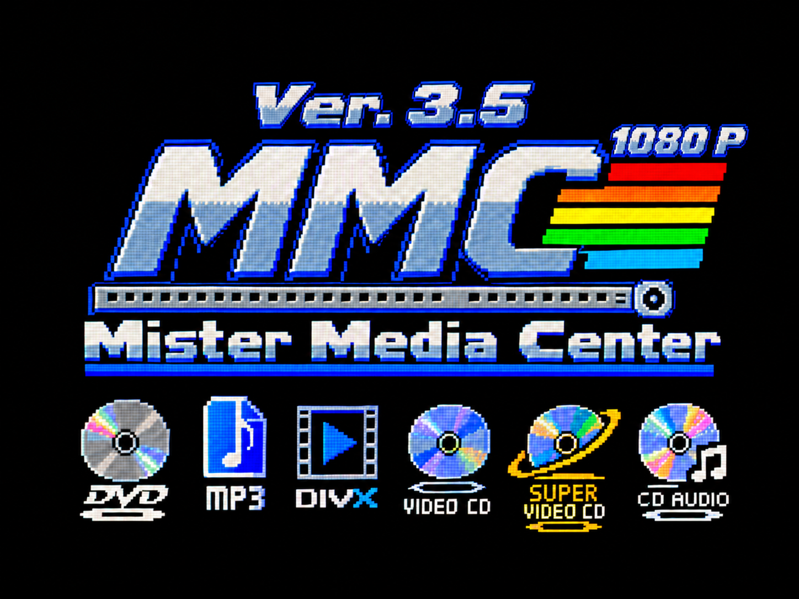

# MiSTer MediaCenter (MMC)

[Italiano](README.md) · **English**

<p align="center"></p>

> This project was developed with the help of artificial intelligence: the code and the documentation were written with Claude, Anthropic's AI, and tested by rgm on a real MiSTer.

## What it is

MiSTer MediaCenter (MMC) turns the MiSTer FPGA (DE10-Nano) into a media player for video and audio discs and files. One program, with the same controls, plays DVD-Video, Video CDs, Super Video CDs, DivX/Xvid/MP4 video and music.

It is made for **standard-definition** formats, at DVD resolution or lower, and for two kinds of screen:

- **LCD TVs**, through HDMI, at the TV's resolution;
- **above all CRT TVs**, through the analog VGA output at **15 kHz**: the video reaches the CRT as its original signal, 576i for PAL DVDs and 480i for NTSC ones, with no conversion, and the picture is fitted to the TV with CRT Adjust.

Both outputs work at the same time: the same video goes to the LCD TV over HDMI and to the CRT over VGA.

The MiSTer's ARM processor reads and decodes discs and files. The FPGA handles the video output: it scales the picture for HDMI and generates the 15 kHz signal for the CRT.

It reads from the USB optical drive, the SD card, USB sticks and network shares.

The package is made of these parts:

| File | Where it goes on the SD card | What it does |
| --- | --- | --- |
| `MiSTer_MediaCenter` | `/media/fat/` | The Main, the MiSTer's main program, used in the menu. When you insert a disc it recognizes it: video discs and data DVDs open with the player, games start with the right core |
| `mediacenter` | `/media/fat/linux/` | The player itself, which runs on the ARM |
| `mediacenter.sh` | `/media/fat/Scripts/` | The script shown in **Scripts**: it opens the player to pick files from SD, USB or network |
| `menu_mediacenter.rbf` | `/media/fat/linux/` | MMC's menu core: the normal MiSTer menu plus the colour conversion and the 15 kHz output for the CRT |
| `libdvdcss.so.2` | `/media/fat/dvdcss/` | The library for reading protected DVDs |
| `MMC_MiSTer_ini.txt` | `/media/fat/` | The lines to copy into `MiSTer.ini` (it is not a `MiSTer.ini`: copy only the lines) |

The old `vcd_player` from the first versions is no longer needed: the Video CD player is inside `mediacenter`.

The player's on-screen texts are in Italian.

## What's new in version 2.6

- **Videos wider than the screen much smoother:** a 1440x810 H.264 MKV lost 63.8% of its pictures, now 1.4%. The player narrows the picture while copying it, without converting the colours: the FPGA does the conversion, as for 720p videos.
- **Back from a PSX game (or another console) with the Physical Disc Main:** if the menu was left to the Physical Disc Main, the **mediacenter** script notices and puts the MMC Main back in its place. How it works in [After a game with the Physical Disc Main](#after-a-game-with-the-physical-disc-main).
- **DVD adverts and trailers without picture:** on some DVDs (for example Shrek 2), after choosing the language you heard the trailers' sound and saw their subtitles, but the picture stayed on the menu. After a part of the disc with sound only, the player dropped every picture as "too far ahead". Now it shows them in time with the sound. The same fix makes menu animations restart properly from the second loop on.
- **Picture diagnosis:** for 30 seconds after every jump or change of part of the disc, the log writes every second how many pictures arrive, how many are shown and how many are dropped, and why.
- The package also holds `MMC_MiSTer_ini.txt`, with the lines to copy into `MiSTer.ini`.

Tested on a real MiSTer on 18 October 2026: 1440x810 MKV smooth (3763 pictures, 44 not shown); Shrek 2 PAL on a CRT with the adverts visible (1775 pictures, 2 dropped); Star Wars Episode III with menus, chapters and audio changes as in 2.5; a PSX game and then the mediacenter script with the MMC core back on the CRT.

## What's new in version 2.5

Version 2.5 is mostly about CRT TVs and DVDs.

- **CRT Adjust:** a new screen, the last entry of the **mediacenter** script, fits the picture to your CRT without opening the TV. It sets **Width**, **Horizontal position**, **Height**, **Vertical position**, **15 kHz mode** and **Flicker filter**, and shows the resolution **measured** on the output. Details in [CRT Adjust](#crt-adjust-geometry). This feature was made possible by the work of Umberto Parisi of [Beceri Videoludici](https://youtube.com/@rmonic79_ibecerivideoludici) (see [Thanks](#thanks)).
- **True interlaced DVDs on the CRT:** the menu core changes picture only at the start of a field. PAL DVDs at 576i 50 Hz and NTSC ones at 480i 60 Hz play smoothly, with no jumping lines and no torn pictures.
- **Lists drawn for the CRT:** the file list and CRT Adjust are drawn 640 pixels wide with the lines of the CRT mode, with bold titles and entries. Text stays whole and readable at 15 kHz too.
- **Flicker filter** in the FPGA core: thin white text no longer flickers on the interlaced output.
- **Controls and subtitles readable on the CRT:** larger characters, controls on two rows with a line for audio and subtitles, and subtitles move above the controls while these are shown.
- **Diagnosis lines in the log** (`mediacenter: diag ...`): for every stutter they say how many pictures were dropped and why (disc read, decoding, drawing, sound). They help understand problems from your tests. `MC_DIAG=0` in `mediacenter.ini` turns them off.

Fixes:

- **CRT after a game:** back in the menu after a core, the MiSTer loaded the stock menu and the CRT showed only noise or the "modify MiSTer.ini" warning until power off. The MMC Main now always reloads its own menu core.
- **DVDs on the CRT with jumping lines and torn pictures** every 10-15 seconds: fixed in the core, which takes the new page address only once it is stable, and in the player.
- **Audio track change** from 5.1 to the 2-channel commentary: the picture stopped for about 5 seconds. The video now never waits and the new sound starts at the film's position.
- **DVD started from the mediacenter script** slower (18% of pictures dropped): the player now uses both ARM cores however it is started.
- **Small stutters during the film** (100-200 ms): the player asked libdvdnav for the DVD state while it was reading the disc, and had to wait. The state is now copied by the disc reader.
- **DVD menus:** chapter selection no longer stutters, because highlighted buttons are prepared once instead of for every picture. Menu text appears at once and complete, instead of on the second loop of the music: the player pushes the menu's last picture out of the decoder as soon as the disc signals the end of the video sequence, like set-top players.
- **Joypad keys written over the DVD menu:** the Linux console now stays hidden while the player is open.
- **Disc starting again by itself** after stop and exit: the Main ignores the disc in the drive until it is removed.

Tested on a real MiSTer on 17 and 18 October 2026, on Sony Trinitron CRTs over SCART RGB (also on a second CRT): protected PAL DVD with menus, chapter selection and three audio tracks with the commentary; 3709 film pictures with only 3 dropped; DivX and MP4.

## What's new in version 2.1

- **Working 15 kHz output for CRTs:** the player's video now reaches the CRT TV from the analog VGA output (tested with a SCART RGB cable on a Trinitron). With 2.0 the CRT only showed the menu background, because the Main never told the menu core there was a picture to show.
- **Main updated** to the official MiSTer Main of 16 October 2026: HDMI fixes (TV detection, `vsync_adjust=2`) and everything new for the other cores.
- With `vga_scaler=0` the "If you see this, then you need to modify MiSTer.ini" warning no longer appears over the player.

Fixes:

- **CRT with no picture:** with 2.0, on the VGA output without the scaler you only saw the menu's noise. The Main wrote the bit that tells the core "there is a Linux picture to show" the wrong way (a bug in the official Main, fixed on 1 October 2026). Now the core receives it and brings the video to the CRT.
- **DivX cut on the right over HDMI:** a 576x432 video was doubled to 1152 pixels, but on a 720p TV the 4:3 window is 960 pixels wide and the scaler, in this mode, cannot shrink: only the first 960 pixels were shown. Now the player prepares the picture already at the window's size.
- **Warning over the player:** the official Main shows a warning on the VGA when the Linux frame buffer is on and the scaler is off, because the stock menu cannot show it. MMC's core does show it, so with MMC the warning no longer appears.

Tested on a real MiSTer (16 October 2026): DVD and DivX over HDMI at 720p and on a CRT at 15 kHz interlaced, both with the previous official Main and with the latest official Main installed as `/media/fat/MiSTer`, the one used by the other cores.

## How it works (technical part)

The MiSTer has two halves: a dual-core 800 MHz Cortex-A9 **ARM** processor running Linux, and an **FPGA** that generates the video outputs. MMC splits the work like this: the ARM reads and decodes, the FPGA shows. The FPGA does not decode video.

### ARM side

**The Main (`MiSTer_MediaCenter`)** is the MiSTer Main with disc detection added:

- when you insert a disc it examines it once: DVD-Video, Video CD, Super Video CD and data DVDs with video files are opened with the player, games are started with the console's core;
- it receives the player's `fb_cmd3` commands (frame buffer format and size, page to show, CRT Adjust, 15 kHz mode) and passes them to the FPGA;
- it measures the signal actually coming out of the core and writes it to `/tmp/mediacenter_crt`;
- if it finds the stock menu loaded, for example when coming back from a game, it reloads the MMC core.

**The player (`mediacenter`)** is a single program for discs and files, using both ARM cores:

- one thread reads the disc: DVDs through libdvdnav and libdvdcss (menus, buttons, chapters, still pictures), Video CDs and Super Video CDs straight from the sectors;
- FFmpeg decodes the video (MPEG-1, MPEG-2, MPEG-4, H.264…) in a thread of its own, and the sound (AC3, DTS, MPEG, AAC…);
- the sound goes to the MiSTer's audio output, and the video follows the audio clock to stay in sync;
- with interlaced DVDs the player blends the two fields of each picture (`MC_FIELDS=1` keeps them apart);
- subtitles, DVD menu buttons and on-screen controls are drawn over the picture;
- every picture is copied to the frame buffer, an area of DDR memory shared with the FPGA, in YUV 4:2:2 format, without converting the colours.

The frame buffer has three pages: the ARM writes the next picture into one page while the FPGA shows another, then tells the Main which one to show (`fb_cmd3 page`). With a 720p H.264 video the ARM takes about 30 ms to decode a picture and 5.5 ms to copy it, out of the 41.7 ms available at 24 pictures per second.

### FPGA side (`menu_mediacenter.rbf` core)

It is the MiSTer menu core with two additions, which read the same frame buffer from DDR memory:

- **HDMI:** the MiSTer scaler carries the picture in YUV up to the output, converts it to RGB at the end and enlarges it to the TV's resolution (`video_mode`) with the right shape. Converting the colours in the FPGA saves the ARM about 16 ms per picture.
- **15 kHz CRT (`mc_out` module):** generates the CRT signal by itself, independent of HDMI: 576i or 480i for video, following a PAL or NTSC DVD, or 288p or 240p when forced in CRT Adjust. It converts the colours, narrows the picture to 640 pixels, adds black bars to 16:9 films and applies CRT Adjust by redrawing the picture in the new rectangle without touching the sync, so the CRT never loses lock. It changes page only at the start of a field and only once the address is stable, so the picture never tears. The flicker filter averages each line with the one below.

The two outputs work together: the same picture goes to HDMI and VGA at the same time. There is a single sound stream, which reaches HDMI, the analog output and the optical output together.

The FPGA does not decode video: an H.264 decoder does not fit and there is no free one suited to the MiSTer. That is why the practical limit is 720p H.264.

## What's new in version 2.0

- **Colours converted by the FPGA:** the menu core converts colours from YUV to RGB, work the ARM used to do. 720p H.264 MP4 video now plays smoothly: frames not shown drop from 10% to about 2%.
- **Audio and video in sync:** the picture waits for the sound when needed, slowing down slightly instead of stuttering. Changing audio track during a film (for example from 5.1 to a stereo commentary) is seamless.
- **Super Video CD:** discs with PBC menus, and now also `.bin` + `.cue` images copied to the SD card.
- **15 kHz VGA output for CRTs** from the menu core, alongside HDMI.
- **Living alongside the Physical Disc Main:** game discs are now handled by the Physical Disc Main inside the console cores; MMC takes care of video discs and files.
- **Settings file** `/media/fat/linux/mediacenter.ini` to adjust the player without editing scripts.
- Videos wider than the screen (for example 1440x810) are now shown whole, narrowed to the screen width.

## Living alongside MiSTer Physical Disc

MMC works together with Anime0t4ku's [MiSTer Physical Disc](https://github.com/Anime0t4ku/Main_MiSTer_Physical_Disc) Main (`MiSTer_Physical-CD`), installed separately. Each does its own part:

| Who | Where it works | What it does |
| --- | --- | --- |
| **MiSTer MediaCenter** | In the MiSTer menu | Recognizes the inserted disc. DVD-Video, Video CDs, Super Video CDs and data DVDs open with the player; games start with the `_Physical Disc Cores` core |
| **MiSTer Physical Disc** | Inside the console cores | Reads the game disc: Q subchannel, PSX LibCrypt protection, CD+G karaoke on the Mega CD, CHD images |

The MiSTer switches between the two Mains by itself, following the `main=` lines in `MiSTer.ini`.

### Setup to use them together

Both Mains go in the root of the SD card:

| File | Where from |
| --- | --- |
| `/media/fat/MiSTer_MediaCenter` | This project ([Releases](../../releases)) |
| `/media/fat/MiSTer_Physical-CD` | [MiSTer Physical Disc](https://github.com/Anime0t4ku/Main_MiSTer_Physical_Disc/releases) |

Then add these lines to `/media/fat/MiSTer.ini` (if the sections already exist, only fix the `main=` line):

```ini
; MiSTer menu: MiSTer MediaCenter recognizes discs
; and opens DVDs, Video CDs, Super Video CDs and video files
[menu]
main=MiSTer_MediaCenter
PHYSICAL_DISC_BOOT=1

; Game disc cores (_Physical Disc Cores): the Physical
; Disc Main reads the disc (PSX, Saturn, Mega CD...)
[A0CD-*]
main=MiSTer_Physical-CD
```

Restart the MiSTer. From then on:

1. MiSTer MediaCenter runs in the menu: insert a DVD or a Video CD and the player starts; insert a game and MMC starts the right core;
2. as soon as the game core starts, the MiSTer switches by itself to the Physical Disc Main, which reads the disc;
3. when you leave the game and go back to the menu, the MiSTer switches back to MiSTer MediaCenter by itself (if sometimes it does not, see [After a game with the Physical Disc Main](#after-a-game-with-the-physical-disc-main)).

Note:

- each section takes **a single** `main=` line: if there are two only the last one counts, so do not put both Mains in the same section;
- if the Physical Disc Main file on your SD card has another name, write that after `main=`;
- without the `[A0CD-*]` section games start but the disc is not read;
- `PHYSICAL_DISC_BOOT=1` is optional: it starts the disc already in the drive at power-on;
- Physical Disc Main options (for example `MEGACD_SUBCODE_LOG`) go in the `[A0CD-*]` section.

The other settings are explained in [Installation](#3-edit-mediafatmisterini).

If you insert a DVD while a game is running, go back to the MiSTer menu: MMC recognizes it there and starts it.

### After a game with the Physical Disc Main

Sometimes, when you leave a game (for example a PSX game with OSD → **Reset/Exit**), the menu stays with the Physical Disc Main instead of going back to MiSTer MediaCenter. The Physical Disc Main loads the normal MiSTer menu, without MMC's CRT part. You can tell because the HDMI TV shows the menu, while the CRT shows the notice "If you see this, then you need to modify MiSTer.ini".

Since version 2.6 the **mediacenter** script notices this by itself:

1. start **mediacenter** from **Scripts** as usual;
2. if another Main is running the menu, the script shows "Riavvio il Main di MiSTer MediaCenter" (restarting the MiSTer MediaCenter Main) for a few seconds, closes that Main and starts `MiSTer_MediaCenter`;
3. the MMC Main reloads its menu core and the CRT is back to normal;
4. **start mediacenter from Scripts again**: this second time the player starts normally, on both HDMI and the CRT.

Only this second start is needed: no MiSTer restart and no change to `MiSTer.ini`. The script does this only when the `[menu]` section of `MiSTer.ini` has `main=MiSTer_MediaCenter`. The file `/tmp/mediacenter_main.log` keeps the line `script: menu run by ...` with the Main it found.

## What it plays

| Disc or file | How it starts | Features |
| --- | --- | --- |
| DVD-Video, protected originals included (CSS) | Starts by itself when you insert the disc | Disc menus, chapters, audio tracks, subtitles, fast forward and rewind |
| Video CD 1.0, 1.1 and 2.0 | Starts by itself when you insert the disc | PBC menus, chapters, audio channel |
| Super Video CD | Starts by itself when you insert the disc | PBC menus, chapters, audio tracks, fast forward and rewind |
| Super Video CD `.bin` + `.cue` images | From **Scripts → mediacenter**, opening the `.cue` file | As the disc, with its menus |
| Data DVDs (DVD-R or DVD+R) with DivX, MP4, MP3… | The file list opens by itself when you insert the disc | As for files |
| DivX, Xvid, MP4, MKV, MPEG and VOB video | From **Scripts → mediacenter**, choosing SD, USB or network | Audio tracks, chapters (or 60-second jumps), fast forward and rewind |
| DVD `.iso` images and `VIDEO_TS` folders | From **Scripts → mediacenter** | As a DVD |
| MP1, MP2, MP3, Ogg, FLAC, WAV and AAC music | From **Scripts → mediacenter** | The tracks of a folder play one after the other, like an album |
| Audio CDs | Start by themselves, with the core set in `AUDIOCD=` or with [MiSTer Hi-Fi](https://github.com/Anime0t4ku/MiSTer_Hi-Fi) | |
| PSX, Saturn, Mega CD, PC Engine CD… games | Start by themselves, with the `_Physical Disc Cores` | Handled by the Physical Disc Main |

CD-Rs with DivX or MP3 files do not start by themselves: open them from **Scripts → mediacenter → Disco nel lettore**.

## Formats and recommended resolutions

MMC is made for standard-definition video. These are the recommended maximum resolutions:

| Format | Recommended maximum resolution | Result |
| --- | --- | --- |
| DVD-Video (MPEG-2) | 720x576 (PAL), 720x480 (NTSC) | Perfect |
| Video CD (MPEG-1) | 352x288 (PAL), 352x240 (NTSC) | Perfect |
| Super Video CD (MPEG-2) | 480x576 (PAL), 480x480 (NTSC) | Perfect |
| DivX, Xvid (MPEG-4) | 720x576 | Smooth |
| MP4, MKV in 8-bit H.264 | 1280x720 | Smooth |
| Music | Any | Perfect |

**Video above 720p, 10-bit H.264 (Hi10p) and HEVC/H.265 are not recommended.** They play, with smooth audio, but the MiSTer cannot show every frame and the picture stutters. Measured on a real MiSTer:

| Video | Frames not shown |
| --- | --- |
| DVD (MPEG-2 720x576) | less than 1% |
| 8-bit H.264 1280x720 | 1.4–2.5% (was 10% before the FPGA converted the colours) |
| 8-bit H.264 1440x810 | about 1.4% (was about 65% up to 2.5) |
| 10-bit H.264 (Hi10p) 1280x720 | about 78% (measured with version 1.0) |

With a 720p H.264 video the ARM needs about 30 ms to decode a picture, out of 41.7 ms available at 24 pictures per second. That is why the colour conversion, which took another 16 ms, moved to the FPGA: the ARM now copies the picture in 5.5 ms.

The limit is in the hardware, on both sides:

- **ARM:** all decoding runs on the DE10-Nano's 800 MHz ARM Cortex-A9, which has no hardware video decoder. It is enough for DVDs and DivX, not for high-definition H.264.
- **FPGA:** there is no room for an H.264 decoder, and no free one suited to the MiSTer exists. So the FPGA handles the video output (colour conversion, scaling for HDMI and the 15 kHz signal), not decoding.

On a CRT, high definition brings nothing anyway: the picture is brought back to 480 or 576 lines.

To watch an HD video, convert it to DVD resolution, for example with HandBrake: H.264 encoder, High profile, 8-bit, or Xvid. Avoid 10-bit H.264 (Hi10p) and HEVC/H.265.

## Video output: HDMI and 15 kHz CRT

- **HDMI (LCD TV):** the FPGA scaler enlarges the video to the resolution set with `video_mode` in `MiSTer.ini`, with the right shape (4:3, 16:9, 2.35:1 with black bars).
- **15 kHz VGA (CRT TV):** the `menu_mediacenter.rbf` core sends the video to the CRT as its original signal. The player's lists come out at 480i (576i with `menu_pal=1` in `MiSTer.ini`); a DVD comes out interlaced at 576i (PAL) or 480i (NTSC), as from a DVD player, and in Auto mode the CRT changes frequency by itself; a 16:9 film is shown with black bars above and below (letterbox).

MMC does not need to force anything: HDMI and CRT work with the MiSTer's normal settings. The general `[MiSTer]` part of `MiSTer.ini` just needs the scaler not to be sent to the VGA:

```ini
[MiSTer]
vga_scaler=0          ; VGA carries the core's signal, not the scaler's
forced_scandoubler=0  ; the CRT gets 15 kHz
composite_sync=1      ; only with a SCART cable (composite sync)
video_mode=0          ; HDMI resolution, for example 1280x720
```

Do **not** put `vga_scaler=1`, `video_mode`, `direct_video` or other scaler overrides in the `[menu]` section: they apply only to the menu, where MMC runs, and replace the general settings. With `vga_scaler=1` and a 240-line `video_mode`, for example, the CRT gets the scaler's picture, narrow and cut at the sides.

Tested by rgm on a Sony Trinitron TV with a SCART RGB cable: DVD and DivX centred and whole, interlaced at 576i; at the same time HDMI at 720p correct.

### CRT Adjust (geometry)

If the CRT's geometry is off, the picture can be narrowed, widened and moved without touching the TV's trimmers. Open the **mediacenter** script and pick the last entry, **Regola CRT (dimensioni e posizione)**. A test picture with a red border appears: adjust **Larghezza** (width), **Posizione orizzontale** (horizontal position), **Altezza** (height) and **Posizione verticale** (vertical position) until the border touches the sides of the screen.

| Button | What it does |
| --- | --- |
| ▲ ▼ | Picks the entry |
| ◄ ► | Changes the value by one step (L / R by four steps) |
| A | Saves to `mediacenter.ini` and exits |
| B | Exits without saving |
| Y | Resets everything to zero |

The adjustments apply to the player's video on the 15 kHz output; HDMI does not change. The menu core redraws the picture in the new rectangle without changing the sync, so the CRT never loses lock and the colours stay the original ones. This feature was made possible by the work of Umberto Parisi (rmonic79) of Beceri Videoludici: it comes from his [MiSTer CRT Adjust](https://github.com/rmonic79/MiSTer-CRT-Adjust), adapted to the way MMC draws the picture. Follow their YouTube channel, [I Beceri Videoludici](https://youtube.com/@rmonic79_ibecerivideoludici).

The same screen has two entries for the 15 kHz output, handled by the menu's FPGA core:

| Entry | Values |
| --- | --- |
| **Modo 15 kHz** (15 kHz mode) | **Auto** (576i for PAL DVDs, 480i for NTSC ones; lists in 480i or 576i following `menu_pal`), or fixed **576i PAL**, **288p PAL**, **480i NTSC**, **240p NTSC** |
| **Filtro tremolio** (flicker filter) | **Auto** (on for interlaced lists, off for video and at 288p/240p), **Spento** (off), **Acceso** (on) |

The filter blends every line with the one below it: thin white text no longer flickers on the interlaced output. In Auto it stays off for video because the player already smooths the controls and subtitles, and the film stays sharp.

Below the entries, **Misurata** (measured) shows the mode the Main actually measures on the core's output (for example `640x576i 15.63 kHz 50.0 Hz`). The same line, with the expected mode, also goes to `/tmp/mediacenter.log`.

The lists and the CRT Adjust screen use a picture 640 pixels wide with the lines of the chosen mode: 480 in Auto (576 with `menu_pal=1`), or 576, 288, 480 or 240. The CRT shows it pixel for pixel and the text stays whole; HDMI enlarges it. With `MC_MENU_HD=1` in `mediacenter.ini` the lists go back to 1280x720 as in version 2.1.

## Tested on a real MiSTer

Tests run by rgm on a DE10-Nano MiSTer with a Pioneer BDR-TD05 USB drive, HDMI output at 1280x720, up to 18 October 2026; Sony Trinitron CRT over SCART RGB.

| Test | Result |
| --- | --- |
| Protected original PAL DVD (Star Wars Episode III) | Smooth. Menus, chapters, audio tracks, subtitles, fast forward and rewind work |
| DVD with three audio tracks (English 5.1, Italian, stereo commentary) | 4289 pictures, 2 skipped. Sound in sync with the lips; changing track during the film without stutter |
| Video CDs | Perfect, they start by themselves when the disc is inserted |
| Super Video CD (`.bin` + `.cue` image from the SD card) | Menu and all three test entries work |
| Data DVD-R with DivX and MKV files | The file list opens by itself, full-screen video |
| 720p H.264 MP4 (anime, 23.976 pictures per second) | Smooth, 1.4–2.5% of pictures not shown, sound in sync, correct colours with the FPGA conversion |
| 1440x810 H.264 MKV, version 2.6 | Whole and smooth, sound and picture perfect: 3763 pictures, 44 not shown (1.4%; 63.8% with 2.5) |
| DVD on a CRT (15 kHz VGA, SCART RGB), version 2.1 | Picture centred and whole, 576i; DVD menu and film correct |
| 576x432 DivX over HDMI 720p and on a CRT, version 2.1 | Whole on both outputs (before 2.1 it was cut on the right over HDMI) |
| Latest official Main (16 October 2026) as `/media/fat/MiSTer`, version 2.1 | Everything works, no problems |
| Protected PAL DVD on CRT at 576i 50 Hz, version 2.5 | Smooth: 3709 pictures, 3 dropped; chapter skips with no problems |
| DVD menus on CRT, version 2.5 | Menus and chapter selection smooth, text complete at once |
| Audio track change on CRT, version 2.5 | From 5.1 to the 2-channel commentary and back with no stutter |
| DVD started from the mediacenter script, version 2.5 | As smooth as with the disc inserted |
| Back to the menu after a game, on CRT, version 2.5 | The CRT shows the MMC menu at once |
| CRT Adjust, version 2.5 | Width, positions, height, mode and filter work; measures 480i 60 Hz in lists and 576i 50 Hz with PAL DVDs |
| Protected PAL DVD with adverts after the language choice (Shrek 2), version 2.6 | Adverts with picture, sound and subtitles; then menu and film. 1775 pictures, 2 dropped |
| PSX game with the Physical Disc Main, then the mediacenter script, version 2.6 | The script puts the MMC Main back; on the second start the CRT shows the player |
| Living alongside the Physical Disc Main | DVDs and Video CDs with MMC; a PAL PSX game with LibCrypt (The Legend of Dragoon) starts by itself and works with the Physical Disc Main |

Still to test: Super Video CD read from a burned disc.

## Installation

### 1. Download the files

From the [Releases](../../releases) page download `MiSTer_MediaCenter.zip` and extract it to the root of the SD card (`/media/fat`). The folders in the zip already match the SD card layout. The zip holds everything MMC needs: the Main, the player, the script, the menu core, the library for protected DVDs and `MMC_MiSTer_ini.txt` with the lines for `MiSTer.ini`. The Physical Disc Main, for games, is downloaded from its own project. Always update them together, because the FPGA colour conversion needs the Main and the core of the same version. Restart the MiSTer after copying the Main or the core.

The latest version is on the [Actions](../../actions) page. Open the latest successful run (green tick) of **Build MiSTer MediaCenter** and download `MiSTer_MediaCenter` and `mediacenter_arm`. The menu core is in the **Build MediaCenter menu core** run, file `mediacenter_rbf`.

Also install the [MiSTer Physical Disc](https://github.com/Anime0t4ku/Main_MiSTer_Physical_Disc/releases) Main separately if you want to play original game discs.

### 2. Check where the files are

| File | Location on the SD card |
| --- | --- |
| `MiSTer_MediaCenter` | `/media/fat/MiSTer_MediaCenter` |
| `mediacenter` | `/media/fat/linux/mediacenter` |
| `mediacenter.sh` | `/media/fat/Scripts/mediacenter.sh` |
| `menu_mediacenter.rbf` | `/media/fat/linux/menu_mediacenter.rbf` |
| `MiSTer_Physical-CD` (Physical Disc Main) | `/media/fat/MiSTer_Physical-CD` |

The original Main (`/media/fat/MiSTer`) is left untouched.

Protected DVDs need the `libdvdcss.so.2` library in `/media/fat/dvdcss/`. The zip already includes it: it is [VideoLAN's libdvdcss](https://www.videolan.org/developers/libdvdcss.html) (GPL licence) for ARM, the same one tested on the MiSTer with protected DVDs. This is the same location used by [MiSTer_DVD](https://github.com/owenb321/MiSTer_DVD) and its `install_dvdcss` script. In some countries the law forbids circumventing DVD copy protection: check the rules where you live. Without this file only unprotected DVDs play.

### 3. Edit `/media/fat/MiSTer.ini`

Add these lines, or correct them if they are already there:

```ini
[menu]
main=MiSTer_MediaCenter
PHYSICAL_DISC_BOOT=1

[A0CD-*]
main=MiSTer_Physical-CD
```

- **`[menu]`** uses MiSTer MediaCenter in the MiSTer menu, which is where discs are recognized.
- **`[A0CD-*]`** uses the Physical Disc Main inside the `_Physical Disc Cores` (PSX, Saturn, Mega CD…). Without this line games start but the disc is not read, and a notice appears on screen. If the Physical Disc Main file on your SD card has another name, use that.
- **Each section takes a single `main=` line:** if there are two, only the last one counts. Do not put both Mains in the same section.
- **`PHYSICAL_DISC_BOOT=1`** is optional: at power-on it starts the disc already in the drive, like a console switched on with a disc inside.
- Physical Disc Main options, such as `MEGACD_SUBCODE_LOG` and `MEGACD_CDDA_PACED`, go in the `[A0CD-*]` section.
- HDMI and CRT need no lines in `[menu]`: see [Video output](#video-output-hdmi-and-15-khz-crt) for the general settings.

Other optional settings, in the `[menu]` section:

| Setting | Values | Effect |
| --- | --- | --- |
| `DVD=` | `MEDIACENTER`, `HYBRID`, `FPGA` | Chooses what opens DVD-Video. When missing, `mediacenter` is used; if `mediacenter` is not installed, the [MiSTer_DVD](https://github.com/owenb321/MiSTer_DVD) core opens |
| `AUDIOCD=` | `PSX`, `A0CD-Saturn`, `A0CD-MegaCD`, `MISTERHIFI`, … | Chooses the program or core for audio CDs. With `A0CD-MegaCD`, CD+G karaoke discs show on the Mega CD |
| `PHYSICAL_DISC_MGL=` | `0`, `1` | `0` turns automatic disc detection off |

Restart the MiSTer after the changes.

### 4. Player settings (optional)

The player reads its settings from the text file `/media/fat/linux/mediacenter.ini`, one per line. The file is not needed: create it only if you want to change something.

```ini
# move the sound 50 milliseconds later
MC_AV_OFFSET=0.05
```

| Setting | Effect |
| --- | --- |
| `MC_AV_OFFSET=0.05` | Moves the sound later (positive value) or earlier (negative), in seconds. Useful with TVs that delay the picture |
| `MC_CRT_HSIZE`, `MC_CRT_HPOS`, `MC_CRT_VSIZE`, `MC_CRT_VPOS`, `MC_CRT_MODE`, `MC_CRT_FILTER` | The [CRT Adjust](#crt-adjust-geometry) settings, written by its screen |
| `MC_FIELDS=1` | Interlaced DVDs: sends the two original fields to the CRT instead of blending them. More detail in motion, but fine details flicker a little |
| `MC_NOYUV=1` | Has the ARM convert the colours instead of the FPGA |
| `MC_MENU_HD=1` | Lists at 1280x720 as in version 2.1, instead of drawn for the CRT |
| `MC_DIAG=0` | Turns off the `mediacenter: diag` diagnosis lines in the log |

The same settings can also be given as environment variables, like the test variables below.

## Controls

Use the controller, with the MiSTer menu buttons.

| Button | In the file list | During playback |
| --- | --- | --- |
| A | Opens | DVD: changes subtitles |
| B | Goes back | Stop; on Super Video CDs goes back to the first menu |
| Start | | Play |
| Select | | Pause |
| ◄ ► | Previous/next page | Previous/next chapter; without chapters jumps 60 seconds; in music changes track |
| ▲ ▼ | Up and down | Changes audio track, or the channel (stereo, left, right) |
| L / R | | Rewind / fast forward |
| Y | | DVD, Video CD and Super Video CD: disc menu |
| X | Exits | Exits (confirm with A) |

In a DVD menu the D-pad picks the button, **A** or **Start** confirms it and **Y** returns to the film. In a Video CD or Super Video CD menu ▲▼ pick the entry, **A** starts it and **Start** opens the default one.

## Copying discs to CD-R

Dumping games to CHD files and writing them back to CD-R, keeping the Q subchannel and the PSX LibCrypt protection, is not MMC's job. [MiSTer-Disc-Tools](https://github.com/bonna79/MiSTer-Disc-Tools) does it: it is a separate program, installed on its own. CHD images with subchannel are played with the Physical Disc Main.

## Reporting a problem

Your feedback is very valuable: try MMC with your discs and TVs and write to me, even when everything works. If there are problems, send me the logs.

Open a report on the [Issues](../../issues) page and attach:

1. what you did and what happened: disc or file, title, region (PAL or NTSC);
2. **photos or a video of the screen**, which help a lot;
3. the `/tmp/mediacenter.log`, `/tmp/mediacenter_main.log` and `/tmp/mediacenter_crt` files, copied before switching the MiSTer off, because `/tmp` is cleared at every restart;
4. the video output (HDMI or 15 kHz VGA) and the `MiSTer.ini` lines you changed.

## For developers

### Test variables

| Variable | Effect |
| --- | --- |
| `MC_ARMSCALE=1` | Scales the picture on the ARM instead of the FPGA scaler |
| `MC_NOVSYNC=1` | Draws without waiting for vertical sync |
| `MC_SLOWDRAW=1` | Draws pictures the old way, line by line |
| `MC_DEBUG=1` | Logs DVD navigation events |
| `MC_FULLQUALITY=1` | Turns off the light mode for high-definition H.264/HEVC video (no deblocking, half of the lines enlarged by the FPGA scaler and, above 30 fps, only reference pictures) |
| `MC_TEST=...` | Runs without screen or controller: simulated keys, pictures saved to `/tmp/mc_<seconds>.ppm`. With a `.cue` file it plays a Super Video CD image as if it were in the drive |

To measure decoding speed use `/media/fat/linux/mediacenter --bench <file>` or `--bench /dev/sr0`. It analyzes at most the first minute of the file (Ctrl+C stops it earlier). If the result is above 100% of real time, the file can be played.

During playback `mediacenter` sets the Linux framebuffer to the picture size with the `fb_cmd3` command, which only exists in this Main. The scaler then enlarges it to the screen with the right shape. Pictures wider than the screen are narrowed on the ARM, because the scaler can only enlarge. With another Main the picture is scaled on the ARM.

### Building

The `.github/workflows/build.yml` workflow builds the Main and the player on every push with ARM GCC 10.2 (`arm-none-linux-gnueabihf`). A commit with `[release]` in its message, or a `v*` tag, publishes a release with the zip; the version number is in the `VERSION` file. The `.github/workflows/fpga.yml` workflow builds the menu core (`fpga/menu`) with Quartus 17.0.

Locally, `make` builds the Main. `mediacenter` needs FFmpeg 6.1.2, libdvdread 6.1.3 and libdvdnav 6.1.1, built statically for the ARM:

```sh
git clone --depth 1 -b n6.1.2 https://github.com/FFmpeg/FFmpeg.git ffmpeg-src
tools/mediacenter/build_ffmpeg.sh ffmpeg-src ffmpeg-arm
curl -fsSL https://download.videolan.org/pub/videolan/libdvdread/6.1.3/libdvdread-6.1.3.tar.bz2 | tar -xj
curl -fsSL https://download.videolan.org/pub/videolan/libdvdnav/6.1.1/libdvdnav-6.1.1.tar.bz2 | tar -xj
tools/mediacenter/build_dvdnav.sh libdvdread-6.1.3 libdvdnav-6.1.1 dvdnav-arm
make mediacenter FFMPEG=$PWD/ffmpeg-arm DVDNAV=$PWD/dvdnav-arm
```

## Thanks

- **Umberto Parisi** (rmonic79) of **Beceri Videoludici**: CRT Adjust was made possible by his work on [MiSTer CRT Adjust](https://github.com/rmonic79/MiSTer-CRT-Adjust). Thanks to him, and I recommend following their YouTube channel: [I Beceri Videoludici](https://youtube.com/@rmonic79_ibecerivideoludici).
- **Max Riptide**, for the many tests and suggestions.
- **Simone Roncaglio**, for the ideas suggested to improve MMC.

## Origin and license

MiSTer MediaCenter derives from [Main_MiSTer](https://github.com/MiSTer-devel/Main_MiSTer), the MiSTer menu core and Anime0t4ku's Physical Disc support for physical discs. It uses FFmpeg, libdvdread and libdvdnav. It is distributed under the GPL-3.0 license, like the projects it derives from: see [LICENSE](LICENSE) and [NOTICE](NOTICE).
