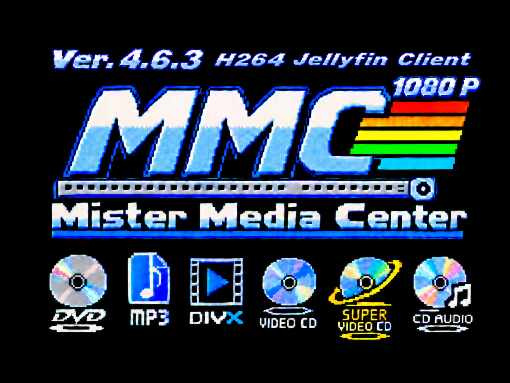

> Sviluppato con l'aiuto dell'intelligenza artificiale (Claude di Anthropic). / Developed with the help of AI (Anthropic's Claude).

**MiSTer MediaCenter 4.6** trasforma il MiSTer in un lettore per DVD-Video, Video CD, Super Video CD, video DivX/Xvid/MP4/MKV e musica, da disco, SD, USB, rete e server Jellyfin, su HDMI e su CRT a 15 kHz.

**Novità della 4.6:**

- **Menu in inglese:** con `MC_LANG=en` in `mediacenter.ini`, oppure dalla pagina Impostazioni, le scritte di MMC sono in inglese (elenchi, comandi durante il video, schermata audio, Jellyfin, Regola CRT).
- **Pagina Impostazioni** nell'elenco delle sorgenti: lingua del menu, lingua audio e dei sottotitoli preferite (per DVD e file), ritardo audio (da -1000 a +1000 ms a passi di 10 ms), Interlacciato Sì (ideale per CRT) / No, e il collegamento a Regola CRT. **A** salva in `mediacenter.ini` solo le righe cambiate, **B** annulla.
- **Riquadro Start durante il film** con tre righe: Formato, Ritardo audio e Interlacciato. Mentre cambi il ritardo il film va in pausa, così l'audio non salta; **A** (Applica) lo conferma, risincronizza l'audio e lo salva.
- **Sottotitoli testo per i file:** file esterni `.srt`, `.ass`, `.ssa`, `.vtt` accanto al video (`film.srt`, `film.ita.srt`…, anche `.srt` salvati da Windows con le lettere accentate), tracce SRT, ASS e WebVTT dentro gli MKV e mov_text dentro gli MP4. Il tasto **A** cambia traccia o li spegne. Sono disegnati sopra il video, quindi funzionano anche con l'acceleratore 1080p e sul CRT. I sottotitoli a immagini (PGS, VobSub) nei file non sono ancora supportati.
- **Nuova immagine** Ver. 4.6 H264 Jellyfin Client 1080 P, mostrata solo quando si apre lo script.

Cambia solo il lettore `mediacenter`, che gira sul processore ARM: il Main e il core del menu (seed 12) sono gli stessi della 4.5. I sottotitoli li disegna l'ARM nello stesso strato dei comandi a schermo, quindi compaiono anche quando le immagini arrivano dall'acceleratore FPGA.

**Documentazione completa (PDF della 4.5, valida anche per la 4.6 per chip, lettore e uscite):** [italiano](https://github.com/bonna79/MiSTer_MediaCenter/releases/download/v4.5/MMC_4.5_documentazione_completa_IT.pdf) · [English](https://github.com/bonna79/MiSTer_MediaCenter/releases/download/v4.5/MMC_4.5_documentation_complete_EN.pdf).

**Nuove impostazioni in `mediacenter.ini`** (si scelgono anche dalla pagina Impostazioni):

| Impostazione | Cosa fa |
| --- | --- |
| `MC_LANG=en` | scritte di MMC in inglese |
| `MC_AUDIO_LANG=` | lingua audio preferita per DVD e file: `it`, `en`, `fr`, `de`, `es`, `ja` |
| `MC_SUB_LANG=` | lingua dei sottotitoli preferita (stessi codici), `off` per spegnerli |

Provata su un MiSTer vero il 14 novembre 2026, su CRT Sony Trinitron (SCART RGB) e HDMI insieme:

| Prova | Risultato |
| --- | --- |
| Menu in inglese con `MC_LANG=en` | Funziona |
| Pagina Impostazioni | Funziona |
| Riquadro Start con formato, ritardo audio e interlacciato | Funziona |
| Sottotitoli esterni `.srt` | Funzionano |

Dettagli nel [README](https://github.com/bonna79/MiSTer_MediaCenter#novità-della-versione-46). Le novità della 4.5 e delle versioni precedenti sono nel [README](https://github.com/bonna79/MiSTer_MediaCenter#novità-della-versione-45).

**Ringraziamenti:**

- **Umberto Parisi** (rmonic79) dei **Beceri Videoludici**: la funzione Regola CRT è stata possibile grazie al suo lavoro su [MiSTer CRT Adjust](https://github.com/rmonic79/MiSTer-CRT-Adjust). Vi consiglio di seguire il loro canale YouTube: [I Beceri Videoludici](https://youtube.com/@rmonic79_ibecerivideoludici).
- **Max Riptide**, per le numerose prove fatte e i suggerimenti.
- **mad4gith**, per le idee suggerite per migliorare MMC.
- **FDA**, per il supporto tecnico e l'aiuto a chiudere il seme 12 del core FPGA.

**Installazione:** estrai `MiSTer_MediaCenter.zip` nella cartella principale della SD: contiene tutto quello che serve a MMC. Aggiorna sempre tutti i file insieme. **Dalla 4.5:** estrai lo zip sopra i file vecchi e riavvia; `MiSTer.ini` e `mediacenter.ini` restano come sono. **Dalla 4.0:** cancella anche il vecchio script `/media/fat/Scripts/mediacenter.sh` (altrimenti negli Scripts compaiono due voci).

| File | Cartella |
| --- | --- |
| `MiSTer_MediaCenter` (Main) | `/media/fat/` |
| `mediacenter` (lettore ARM) | `/media/fat/linux/` |
| `menu_mediacenter.rbf` (core del menu) | `/media/fat/linux/` |
| `Mister_Media_Center.sh` (script) | `/media/fat/Scripts/` |
| `libdvdcss.so.2` | `/media/fat/dvdcss/` |
| `MMC_MiSTer_ini.txt` (righe per `MiSTer.ini`) | `/media/fat/` |

MD5 dei file nello zip: MD5_DA_INSERIRE

Copia in `/media/fat/MiSTer.ini` le righe di `MMC_MiSTer_ini.txt`: `vga_scaler=0`, `forced_scandoubler=0` (e `composite_sync=1` con la SCART) in `[MiSTer]`, `main=MiSTer_MediaCenter` in `[menu]` e `main=MiSTer_Physical-CD` in `[A0CD-*]`. **Non mettere `main=MiSTer_MediaCenter` nella sezione `[MiSTer]`: va solo in `[menu]`.** Il Main di [MiSTer Physical Disc](https://github.com/Anime0t4ku/Main_MiSTer_Physical_Disc/releases), per i giochi su disco, si scarica dal suo progetto. Riavvia il MiSTer. Guida completa nel [README](https://github.com/bonna79/MiSTer_MediaCenter#installazione).

**I vostri commenti sono molto preziosi:** scrivetemi, anche quando funziona tutto. In caso di problemi apri una segnalazione in [Issues](https://github.com/bonna79/MiSTer_MediaCenter/issues) con foto dello schermo e i file `/tmp/mediacenter.log`, `/tmp/mediacenter_main.log` e `/tmp/mediacenter_crt`.

---

**English:** **MiSTer MediaCenter 4.6** turns the MiSTer into a player for DVD-Video, Video CD, Super Video CD, DivX/Xvid/MP4/MKV video and music, from disc, SD, USB, network and Jellyfin server, over HDMI and on a 15 kHz CRT.

**What's new in 4.6:**

- **English menu:** with `MC_LANG=en` in `mediacenter.ini`, or from the Settings page, MMC's text is in English (lists, controls during the video, audio screen, Jellyfin, CRT Adjust).
- **Settings page** in the list of sources: menu language, preferred audio and subtitle language (for DVDs and files), audio delay (from -1000 to +1000 ms in 10 ms steps), Interlaced Yes (best for CRT) / No, and the link to CRT Adjust. **A** writes only the changed lines to `mediacenter.ini`, **B** cancels.
- **Start box during the film** with three rows: Format, Audio delay and Interlaced. While you change the delay the film pauses, so the sound does not jump; **A** (Apply) confirms it, lines the sound up again and saves it.
- **Text subtitles for files:** external `.srt`, `.ass`, `.ssa`, `.vtt` files next to the video (`film.srt`, `film.ita.srt`…, also `.srt` files saved on Windows with accented letters), SRT, ASS and WebVTT tracks inside MKV and mov_text inside MP4. The **A** button changes track or turns them off. They are drawn over the video, so they also work with the 1080p accelerator and on the CRT. Picture subtitles (PGS, VobSub) in files are not supported yet.
- **New picture** Ver. 4.6 H264 Jellyfin Client 1080 P, shown only when the script is opened.

Only the `mediacenter` player changes, the program that runs on the ARM processor: the Main and the menu core (seed 12) are the same as in 4.5. Subtitles are drawn by the ARM in the same layer as the on-screen controls, so they also show when the pictures come from the FPGA accelerator.

**Complete documentation (the 4.5 PDF, still valid for 4.6 on the chip, the player and the outputs):** [English](https://github.com/bonna79/MiSTer_MediaCenter/releases/download/v4.5/MMC_4.5_documentation_complete_EN.pdf) · [italiano](https://github.com/bonna79/MiSTer_MediaCenter/releases/download/v4.5/MMC_4.5_documentazione_completa_IT.pdf).

**New settings in `mediacenter.ini`** (also chosen from the Settings page): `MC_LANG=en` for English text; `MC_AUDIO_LANG=` preferred audio language for DVDs and files (`it`, `en`, `fr`, `de`, `es`, `ja`); `MC_SUB_LANG=` preferred subtitle language (same codes), `off` to turn them off.

Tested on a real MiSTer on 14 November 2026, on a Sony Trinitron CRT (SCART RGB) and HDMI together:

| Test | Result |
| --- | --- |
| English menu with `MC_LANG=en` | Working |
| Settings page | Working |
| Start box with format, audio delay and interlaced | Working |
| External `.srt` subtitles | Working |

Details in the [README](https://github.com/bonna79/MiSTer_MediaCenter/blob/main/README_EN.md#whats-new-in-version-46). What's new in 4.5 and earlier versions is in the [README](https://github.com/bonna79/MiSTer_MediaCenter/blob/main/README_EN.md#whats-new-in-version-45).

**Thanks:** Umberto Parisi (rmonic79) of the Beceri Videoludici, whose work on [MiSTer CRT Adjust](https://github.com/rmonic79/MiSTer-CRT-Adjust) made CRT Adjust possible ([YouTube channel](https://youtube.com/@rmonic79_ibecerivideoludici)); Max Riptide for the many tests and suggestions; mad4gith for the ideas to improve MMC; FDA for the technical support and the help in closing timing on seed 12 of the FPGA core.

**Install:** extract `MiSTer_MediaCenter.zip` to the root of the SD card: it holds everything MMC needs. Always update all files together (**from 4.5:** extract the zip over the old files and restart; `MiSTer.ini` and `mediacenter.ini` stay as they are; **from 4.0:** also delete the old script `/media/fat/Scripts/mediacenter.sh`, otherwise Scripts shows two entries): Main `MiSTer_MediaCenter` to `/media/fat/`, ARM player `mediacenter` and menu core `menu_mediacenter.rbf` to `/media/fat/linux/`, script `Mister_Media_Center.sh` to `/media/fat/Scripts/`, `libdvdcss.so.2` to `/media/fat/dvdcss/`, `MMC_MiSTer_ini.txt` to `/media/fat/` (MD5s as in the Italian table above). Copy the lines of `MMC_MiSTer_ini.txt` into `/media/fat/MiSTer.ini`. **Do not put `main=MiSTer_MediaCenter` in the `[MiSTer]` section: it goes only in `[menu]`.** The [MiSTer Physical Disc](https://github.com/Anime0t4ku/Main_MiSTer_Physical_Disc/releases) Main, for game discs, is downloaded from its own project. Restart the MiSTer. Full guide in the [README](https://github.com/bonna79/MiSTer_MediaCenter/blob/main/README_EN.md#installation).

**Your feedback is very valuable:** write to me, even when everything works. If there are problems, open a report on [Issues](https://github.com/bonna79/MiSTer_MediaCenter/issues) with photos of the screen and the `/tmp/mediacenter.log`, `/tmp/mediacenter_main.log` and `/tmp/mediacenter_crt` files.
