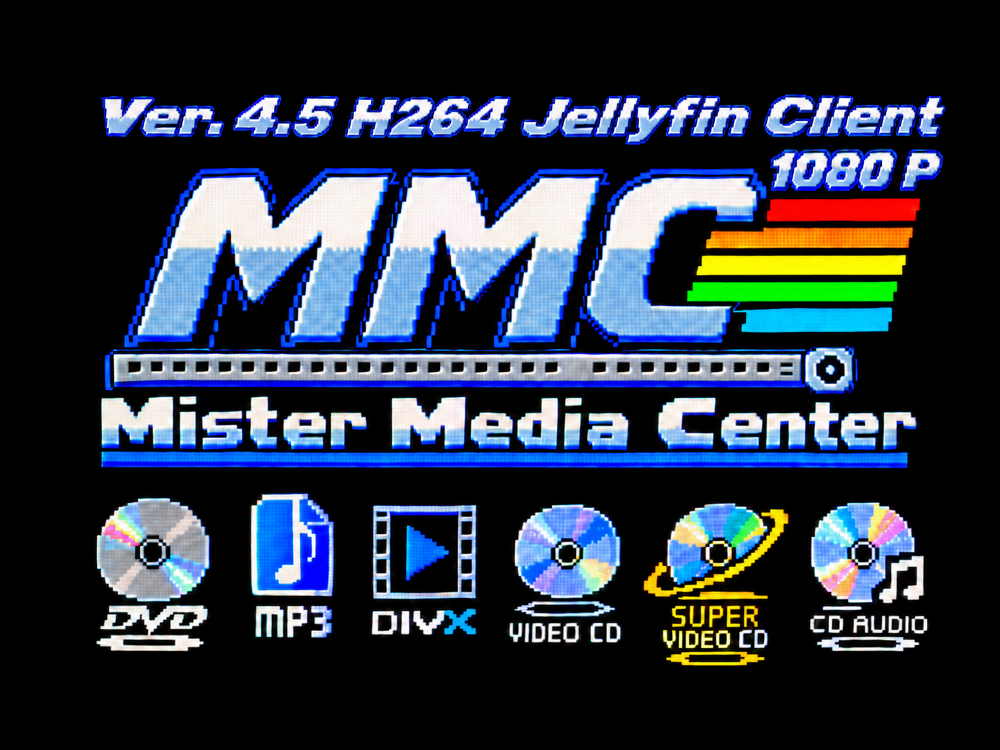

> Sviluppato con l'aiuto dell'intelligenza artificiale (Claude di Anthropic). / Developed with the help of AI (Anthropic's Claude).

**MiSTer MediaCenter 4.5** trasforma il MiSTer in un lettore per DVD-Video, Video CD, Super Video CD, video DivX/Xvid/MP4/MKV e musica, da disco, SD, USB, rete e ora anche da un server **Jellyfin**, su HDMI e su CRT a 15 kHz.

**Novità della 4.5:**

- **Client Jellyfin:** MMC si collega a un server [Jellyfin](https://jellyfin.org) della rete di casa (per esempio sul Mac o sul PC) e mostra film, serie e musica, con Continua a guardare. Trova il server da solo, il primo accesso si fa con il codice Quick Connect o con utente e password. I file che MMC legge arrivano originali, con l'acceleratore FPGA per l'H.264 1080p. Gli altri (HEVC, AV1, 10 bit, 4K…) li converte il server: 1080p a 8 Mbit/s fino a 25 fps, 720p a 6 Mbit/s oltre, al massimo 30 fps. Riprende dal punto lasciato, e la musica si ascolta nella schermata audio. Per il server: [documentazione ufficiale di Jellyfin](https://jellyfin.org/docs/general/installation/) e [Quick Connect](https://jellyfin.org/docs/general/server/quick-connect/).
- **Nuova schermata audio:** onde stereo, equalizzatore a 6 bande e volume da 0 a -5 dB (tasto Y), salvaschermo (A), stop immediato (B).
- **CD audio dentro MMC**, dal lettore o da immagini `.bin`/`.cue`, con i nomi dal CD-Text e i brani senza pause.
- **Altri formati audio:** Opus e moduli tracker MOD, XM, S3M, IT… con libxmp.
- **Main allineato a quello ufficiale dell'11 novembre 2026**, con la nuova mappatura dei controller (joymap v4).
- **Lo script ora si chiama `Mister_Media_Center.sh`** (prima `mediacenter.sh`): cambia solo il nome.
- **Nuova immagine** Ver. 4.5 H264 Jellyfin Client 1080 P, mostrata solo quando si apre lo script. Quando parte un disco si va subito al disco.

Il core del menu è lo stesso della 4.0 (seed 12, lo stesso file byte per byte).

Provata su un MiSTer vero l'11 e il 12 novembre 2026, su CRT Sony Trinitron (SCART RGB) e HDMI insieme, con il server Jellyfin ufficiale su un Mac mini M2 Pro:

| Prova | Risultato |
| --- | --- |
| Controller con la nuova mappatura (joymap v4), nel menu e in MMC | Funzionano |
| DVD originale, CD audio, DVD dati, CRT a 15 kHz | Funzionano come nella 4.0 |
| CD audio, file Opus, moduli tracker, schermata audio con equalizzatore e volume | Funzionano |
| Jellyfin: Inuyasha H.264 1440x810 MKV, file originale con l'acceleratore | 1410 s, 0,0% di immagini non mostrate |
| Jellyfin: Tears of Steel H.264 1728x720, file originale | 734 s, 0,0% di immagini non mostrate |
| Jellyfin: video HEVC a 30 fps convertito dal server in 720p | 0,8% di immagini non mostrate |
| Jellyfin: video HEVC a 59,94 fps convertito in 720p a 30 fps | 0,3% di immagini non mostrate |
| Jellyfin: ripresa dal punto lasciato | Parte in 0,24 s, nessuna immagine saltata, audio pulito |
| Jellyfin: musica FLAC e MP3 | Nessun problema |

Dettagli nel [README](https://github.com/bonna79/MiSTer_MediaCenter#novità-della-versione-45). Le novità della 4.0 e delle versioni precedenti sono nel [README](https://github.com/bonna79/MiSTer_MediaCenter#novità-della-versione-40).

**Ringraziamenti:**

- **Umberto Parisi** (rmonic79) dei **Beceri Videoludici**: la funzione Regola CRT è stata possibile grazie al suo lavoro su [MiSTer CRT Adjust](https://github.com/rmonic79/MiSTer-CRT-Adjust). Vi consiglio di seguire il loro canale YouTube: [I Beceri Videoludici](https://youtube.com/@rmonic79_ibecerivideoludici).
- **Max Riptide**, per le numerose prove fatte e i suggerimenti.
- **mad4gith**, per le idee suggerite per migliorare MMC.

**Installazione:** estrai `MiSTer_MediaCenter.zip` nella cartella principale della SD: contiene tutto quello che serve a MMC. Aggiorna sempre tutti i file insieme. **Dalla 4.0:** estrai lo zip sopra i file vecchi, cancella il vecchio script `/media/fat/Scripts/mediacenter.sh` (altrimenti negli Scripts compaiono due voci) e riavvia. `MiSTer.ini` e `mediacenter.ini` restano come sono.

| File | Cartella |
| --- | --- |
| `MiSTer_MediaCenter` (Main) | `/media/fat/` |
| `mediacenter` (lettore ARM) | `/media/fat/linux/` |
| `menu_mediacenter.rbf` (core del menu) | `/media/fat/linux/` |
| `Mister_Media_Center.sh` (script) | `/media/fat/Scripts/` |
| `libdvdcss.so.2` | `/media/fat/dvdcss/` |
| `MMC_MiSTer_ini.txt` (righe per `MiSTer.ini`) | `/media/fat/` |

Copia in `/media/fat/MiSTer.ini` le righe di `MMC_MiSTer_ini.txt`: `vga_scaler=0`, `forced_scandoubler=0` (e `composite_sync=1` con la SCART) in `[MiSTer]`, `main=MiSTer_MediaCenter` in `[menu]` e `main=MiSTer_Physical-CD` in `[A0CD-*]`. **Non mettere `main=MiSTer_MediaCenter` nella sezione `[MiSTer]`: va solo in `[menu]`.** Il Main di [MiSTer Physical Disc](https://github.com/Anime0t4ku/Main_MiSTer_Physical_Disc/releases), per i giochi su disco, si scarica dal suo progetto. Riavvia il MiSTer. Guida completa nel [README](https://github.com/bonna79/MiSTer_MediaCenter#installazione).

**I vostri commenti sono molto preziosi:** scrivetemi, anche quando funziona tutto. In caso di problemi apri una segnalazione in [Issues](https://github.com/bonna79/MiSTer_MediaCenter/issues) con foto dello schermo e i file `/tmp/mediacenter.log`, `/tmp/mediacenter_main.log` e `/tmp/mediacenter_crt`.

---

**English:** **MiSTer MediaCenter 4.5** turns the MiSTer into a player for DVD-Video, Video CD, Super Video CD, DivX/Xvid/MP4/MKV video and music, from disc, SD, USB, network and now also from a **Jellyfin** server, over HDMI and on a 15 kHz CRT.

**What's new in 4.5:**

- **Jellyfin client:** MMC connects to a [Jellyfin](https://jellyfin.org) server on your home network (for example on a Mac or PC) and shows movies, series and music, with Continue watching. It finds the server by itself; the first sign-in uses a Quick Connect code or a user name and password. Files MMC reads arrive as originals, with the FPGA accelerator for H.264 1080p. The others (HEVC, AV1, 10-bit, 4K…) are converted by the server: 1080p at 8 Mbit/s up to 25 fps, 720p at 6 Mbit/s above, 30 fps at most. It resumes where you left off, and music plays in the audio screen. For the server: [official Jellyfin documentation](https://jellyfin.org/docs/general/installation/) and [Quick Connect](https://jellyfin.org/docs/general/server/quick-connect/).
- **New audio screen:** stereo waves, 6-band equalizer and volume from 0 to -5 dB (Y button), screen saver (A), immediate stop (B).
- **Audio CDs inside MMC**, from the drive or from `.bin`/`.cue` images, with CD-Text names and gapless tracks.
- **More audio formats:** Opus and MOD, XM, S3M, IT… tracker modules through libxmp.
- **Main up to date with the official Main of 11 November 2026**, with the new controller mapping (joymap v4).
- **The script is now called `Mister_Media_Center.sh`** (before: `mediacenter.sh`): only the name changes.
- **New picture** Ver. 4.5 H264 Jellyfin Client 1080 P, shown only when the script is opened. When a disc starts, it goes straight to the disc.

The menu core is the same as in 4.0 (seed 12, the same file byte for byte).

Tested on a real MiSTer on 11 and 12 November 2026, on a Sony Trinitron CRT (SCART RGB) and HDMI together, with the official Jellyfin server on a Mac mini M2 Pro:

| Test | Result |
| --- | --- |
| Controllers with the new mapping (joymap v4), in the menu and in MMC | Working |
| Original DVD, audio CD, data DVD, 15 kHz CRT | Working as in 4.0 |
| Audio CD, Opus files, tracker modules, audio screen with equalizer and volume | Working |
| Jellyfin: Inuyasha H.264 1440x810 MKV, original file with the accelerator | 1410 s, 0.0% of pictures not shown |
| Jellyfin: Tears of Steel H.264 1728x720, original file | 734 s, 0.0% of pictures not shown |
| Jellyfin: HEVC video at 30 fps converted by the server to 720p | 0.8% of pictures not shown |
| Jellyfin: HEVC video at 59.94 fps converted to 720p at 30 fps | 0.3% of pictures not shown |
| Jellyfin: resume where you left off | Starts in 0.24 s, no pictures skipped, clean sound |
| Jellyfin: FLAC and MP3 music | No problems |

Details in the [README](https://github.com/bonna79/MiSTer_MediaCenter/blob/main/README_EN.md#whats-new-in-version-45). What's new in 4.0 and earlier versions is in the [README](https://github.com/bonna79/MiSTer_MediaCenter/blob/main/README_EN.md#whats-new-in-version-40).

**Thanks:** Umberto Parisi (rmonic79) of the Beceri Videoludici, whose work on [MiSTer CRT Adjust](https://github.com/rmonic79/MiSTer-CRT-Adjust) made CRT Adjust possible ([YouTube channel](https://youtube.com/@rmonic79_ibecerivideoludici)); Max Riptide for the many tests and suggestions; mad4gith for the ideas to improve MMC.

**Install:** extract `MiSTer_MediaCenter.zip` to the root of the SD card: it holds everything MMC needs. Always update all files together (**from 4.0:** extract the zip over the old files, delete the old script `/media/fat/Scripts/mediacenter.sh`, otherwise Scripts shows two entries, and restart; `MiSTer.ini` and `mediacenter.ini` stay as they are): Main `MiSTer_MediaCenter` to `/media/fat/`, ARM player `mediacenter` and menu core `menu_mediacenter.rbf` to `/media/fat/linux/`, script `Mister_Media_Center.sh` to `/media/fat/Scripts/`, `libdvdcss.so.2` to `/media/fat/dvdcss/`, `MMC_MiSTer_ini.txt` to `/media/fat/`. Copy the lines of `MMC_MiSTer_ini.txt` into `/media/fat/MiSTer.ini`. **Do not put `main=MiSTer_MediaCenter` in the `[MiSTer]` section: it goes only in `[menu]`.** The [MiSTer Physical Disc](https://github.com/Anime0t4ku/Main_MiSTer_Physical_Disc/releases) Main, for game discs, is downloaded from its own project. Restart the MiSTer. Full guide in the [README](https://github.com/bonna79/MiSTer_MediaCenter/blob/main/README_EN.md#installation).

**Your feedback is very valuable:** write to me, even when everything works. If there are problems, open a report on [Issues](https://github.com/bonna79/MiSTer_MediaCenter/issues) with photos of the screen and the `/tmp/mediacenter.log`, `/tmp/mediacenter_main.log` and `/tmp/mediacenter_crt` files.
